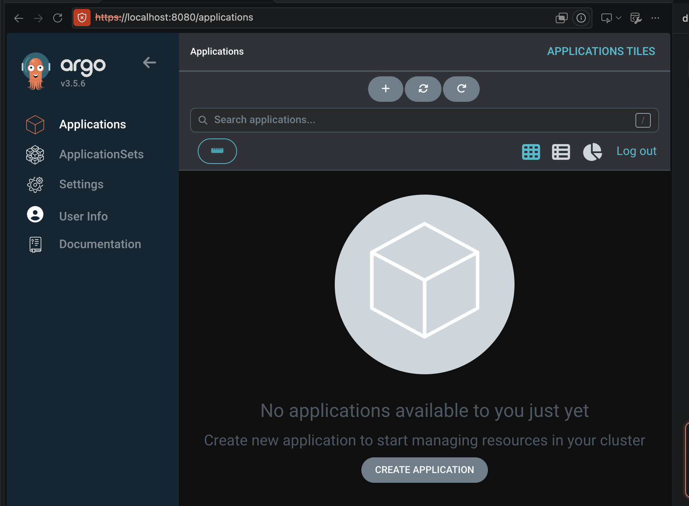
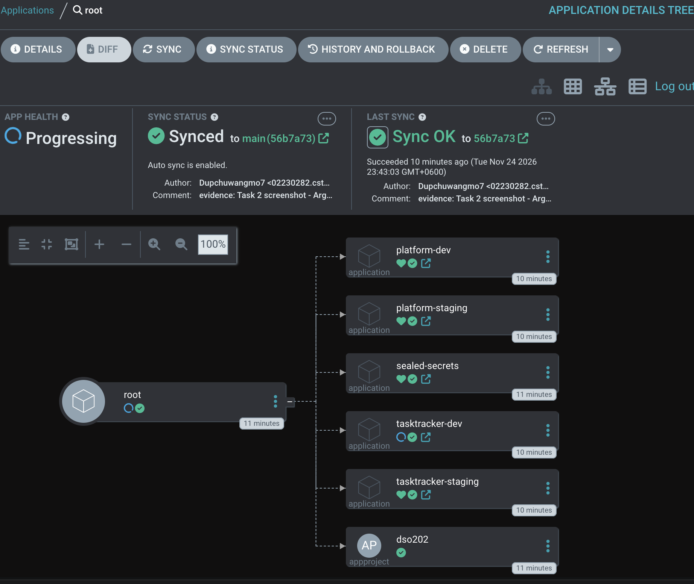
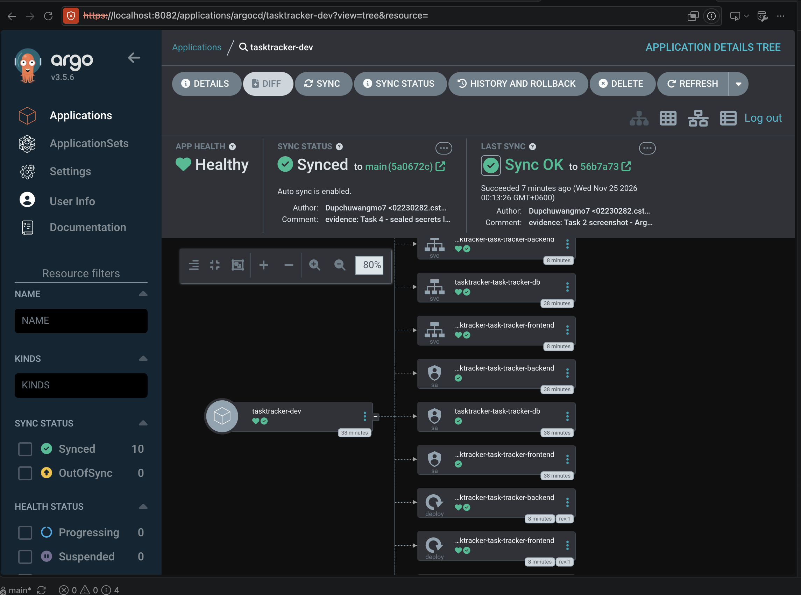

# docs/evidence.md — DSO202 Assignment 4

Command output for every task. Each item shows the command that was run and its
output. Screenshots are noted where the brief requires them.

> Status: skeleton. Each section below is filled from a real run.

## Task 1 — Repository, chart contract and cluster

### §3.2 tool check

```
$ docker version --format '{{.Server.Version}}'
29.4.0

$ kind version
kind v0.32.0 go1.26.3 darwin/arm64

$ kubectl version --client
Client Version: v1.36.3
Kustomize Version: v5.8.1

$ helm version --short
v4.3.0+gbec5b06

$ git --version
git version 2.54.0 (Apple Git-157)

$ argocd version --client
argocd: v3.6.2
  BuildDate: ...
  GitCommit: ...
  GitTreeState: clean
  GoVersion: ...
  Compiler: gc
  Platform: darwin/arm64

$ kubeseal --version
kubeseal version: v0.41.2
```

Drift from the brief (§3.1 pinned versions):

| Component | Pinned | Installed | Note |
|---|---|---|---|
| `argocd` CLI | v3.5.6 | v3.6.2 | Homebrew bottle; direct v3.5.6 binary download hit HTTP/2 PROTOCOL_ERROR against github.com releases. Patch-level ahead; CLI API is stable. |
| `kubeseal` | v0.40.0 | v0.41.2 | Homebrew bottle. CLI still speaks to the pinned controller v0.40.0 installed from the Helm chart. |
| Argo CD server | v3.5.6 | — | Will be installed from `bootstrap/argocd` at the pinned v3.5.6, not from brew. |
| Sealed Secrets controller | v0.40.0 | — | Will be installed from the pinned Helm chart v2.20.0, not from brew. |

- [x] §3.2 tool check output
- [x] chart contract table (in `README.md` §4) — one line per requirement

### `helm lint` — both environments clean

```
$ helm lint charts/tasktracker -f environments/dev/values.yaml
==> Linting charts/tasktracker
[INFO] Chart.yaml: icon is recommended

1 chart(s) linted, 0 chart(s) failed

$ helm lint charts/tasktracker -f environments/staging/values.yaml
==> Linting charts/tasktracker
[INFO] Chart.yaml: icon is recommended

1 chart(s) linted, 0 chart(s) failed
```

### Kinds rendered — only the six whitelisted (contract C8)

```
$ helm template tasktracker charts/tasktracker -f environments/dev/values.yaml \
    | grep '^kind:' | sort | uniq -c
   1 kind: ConfigMap
   2 kind: Deployment
   1 kind: Job
   3 kind: Service
   3 kind: ServiceAccount
   1 kind: StatefulSet
```

No `Secret`, `Namespace`, `ResourceQuota`, `LimitRange`, `Role` or `RoleBinding`
is emitted; those live in `platform/<env>/`.

### Cluster up, port 30080 mapped to the new cluster

```
$ kind get clusters
dso202-assignment-01
dso202-assignment-02
dso202-assignment-03
dso202-gitops
kind

$ kubectl config current-context
kind-dso202-gitops

$ kubectl get nodes
NAME                          STATUS   ROLES           AGE   VERSION
dso202-gitops-control-plane   Ready    control-plane   22s   v1.36.1

$ docker ps --filter name=dso202-gitops --format '{{.Names}} {{.Ports}}'
dso202-gitops-control-plane 0.0.0.0:30080->30080/tcp, 127.0.0.1:59372->6443/tcp
```

- [x] `helm lint charts/tasktracker -f environments/dev/values.yaml`
- [x] `helm lint charts/tasktracker -f environments/staging/values.yaml`
- [x] `helm template tasktracker charts/tasktracker -f environments/dev/values.yaml | grep '^kind:' | sort | uniq -c`
- [x] `kind get clusters`, `kubectl get nodes`
- [x] `docker ps --filter name=dso202-gitops --format '{{.Names}} {{.Ports}}'` showing 30080

## Task 2 — Install Argo CD declaratively

### Rendered workload counts (6 Deployments, 1 StatefulSet)

```
$ kubectl kustomize bootstrap/argocd | grep -E '^kind: (Deployment|StatefulSet)$' | sort | uniq -c
   6 kind: Deployment
   1 kind: StatefulSet
```

### Images — Argo CD pinned to v3.5.6, none from Docker Hub

```
$ kubectl kustomize bootstrap/argocd | grep 'image:' | sort -u
        image: ghcr.io/dexidp/dex:v2.45.1
        image: public.ecr.aws/docker/library/redis:8.2.3-alpine
        image: quay.io/argoproj/argocd:v3.5.6
```

### Seven Pods Running after `kubectl apply -k bootstrap/argocd --server-side --force-conflicts`

```
$ kubectl get pods -n argocd
NAME                                                READY   STATUS    RESTARTS   AGE
argocd-application-controller-0                     1/1     Running   0          4m44s
argocd-applicationset-controller-58bb5c7479-vk8b9   1/1     Running   0          4m44s
argocd-dex-server-dd6b85d9c-frtkx                   1/1     Running   0          4m44s
argocd-notifications-controller-6b85c65458-wnrv7    1/1     Running   0          4m44s
argocd-redis-869b85489d-m6k6h                       1/1     Running   0          4m44s
argocd-repo-server-5bf66565cd-ws6sw                 1/1     Running   0          4m44s
argocd-server-7474bb8f76-xxsks                      1/1     Running   0          4m44s
```

### CRDs installed

```
$ kubectl get crd | grep argoproj.io
applications.argoproj.io      2026-11-24T17:28:47Z
applicationsets.argoproj.io   2026-11-24T17:28:48Z
appprojects.argoproj.io       2026-11-24T17:28:48Z
```

### ConfigMap patches took effect

```
$ kubectl get configmap argocd-cm -n argocd -o yaml | grep -E 'timeout.reconciliation|accounts.reviewer'
  accounts.reviewer: login
  timeout.reconciliation: 60s
  timeout.reconciliation.jitter: 10s
```

### `argocd version` — CLI logged in, server at v3.5.6

```
$ argocd login localhost:8080 --username admin --insecure
'admin:login' logged in successfully

$ argocd version
argocd: v3.6.2
  …
argocd-server: v3.5.6
  BuildDate: 2026-10-20T18:33:20Z
```

The CLI is v3.6.2 (Homebrew; pinned binary download failed earlier) but
the **server itself is v3.5.6** as the brief pins.

- [x] `kubectl kustomize bootstrap/argocd | grep -E '^kind: (Deployment|StatefulSet)$' | sort | uniq -c`  (expect 6 Deployments, 1 StatefulSet)
- [x] `kubectl kustomize bootstrap/argocd | grep 'image:' | sort -u`  (dex, redis, argocd v3.5.6; none from Docker Hub)
- [x] `kubectl get pods -n argocd`  (seven Running)
- [x] `kubectl get crd | grep argoproj.io`  (applications, appprojects, applicationsets)
- [x] `kubectl get configmap argocd-cm -n argocd -o yaml | grep -E 'timeout.reconciliation|accounts.reviewer'`
- [x] `argocd version`
- [x] **screenshot**: Argo CD UI after sign-in → `screenshots/task2-argocd-ui-signed-in.png`



## Task 3 — AppProjects and the root Application

### Immediately after `kubectl apply -f bootstrap/root/`

```
appproject.argoproj.io/platform created
application.argoproj.io/root created
```

### After root reconciled — dso202 project + 5 child Applications appeared

```
$ kubectl get appproject,application -n argocd
NAME                              AGE
appproject.argoproj.io/default    13m
appproject.argoproj.io/dso202     20s     ← created by root, from argocd/projects/
appproject.argoproj.io/platform   26s     ← created by hand from bootstrap/root/

NAME                           SYNC STATUS   HEALTH STATUS
application.argoproj.io/platform-dev          Synced        Healthy
application.argoproj.io/platform-staging      Synced        Healthy
application.argoproj.io/root                  Synced        Progressing
application.argoproj.io/sealed-secrets        Synced        Healthy
application.argoproj.io/tasktracker-dev       OutOfSync     Progressing
application.argoproj.io/tasktracker-staging   Unknown       Healthy
```

`root` is Progressing because `tasktracker-dev` can't become Healthy
yet — the chart references `tasktracker-credentials`, which Sealed
Secrets will create once Task 4 seals the file. Once that lands,
`root` goes Synced + Healthy on its own.

### `argocd app get root` — resource tree shows the children it owns

```
$ argocd app get root
Name:               argocd/root
Project:            platform
Source:
- Repo:             https://github.com/Dupchuwangmo7/DSO202-Assignment4.git
  Target:           main
  Path:             argocd
Sync Policy:        Automated (Prune)
Sync Status:        Synced to main (56b7a73)
Health Status:      Progressing

GROUP        KIND         NAMESPACE  NAME                 STATUS  HEALTH
argoproj.io  Application  argocd     tasktracker-staging  Synced  Healthy
argoproj.io  Application  argocd     tasktracker-dev      Synced  Progressing
argoproj.io  AppProject   argocd     dso202               Synced
argoproj.io  Application  argocd     platform-dev         Synced  Healthy
argoproj.io  Application  argocd     platform-staging     Synced  Healthy
argoproj.io  Application  argocd     sealed-secrets       Synced  Healthy
```

### `argocd proj get dso202` — the workload project materialised from Git

```
$ argocd proj get dso202
Name:                        dso202
Description:                 Task Tracker workloads for the dev and staging environments
Destinations:                https://kubernetes.default.svc,dso202-dev
                             https://kubernetes.default.svc,dso202-staging
Repositories:                https://github.com/Dupchuwangmo7/DSO202-Assignment4.git
```

### Allowed-resource whitelist (from `argocd/projects/dso202.yaml`)

Namespaced only — no cluster-scoped kinds. The chart renders only the
six workload kinds (ConfigMap, Deployment, Job, Service,
ServiceAccount, StatefulSet) and Sealed Secrets contributes a
SealedSecret and the Secret it decrypts into. No whitelist entries are
additions over the brief's minimum.

- [x] `kubectl get appproject,application -n argocd`
- [x] `argocd app get root`  (Synced; Healthy pending Task 4 as noted above)
- [x] `argocd proj get dso202`
- [x] final whitelist, with a comment for any addition
- [x] **screenshot**: root Application resource tree → `screenshots/task3-root-app-tree.png`
- [x] Q1 answered in README



## Task 4 — Platform layer and Sealed Secrets

### Sealing key backup — taken BEFORE anything was sealed

```
$ ls -l ../dso202-keys/
total 16
-rw-------@ 1 dupchuuw  staff  7087 Nov 24 23:55 sealing-key.backup.yaml
```

Directory mode `0700`, file mode `0600`, owner-only. Contents are **not**
printed here (the key is the single point of failure for every
SealedSecret in Git).

### Applications, controller, CRD

```
$ kubectl get application -n argocd
NAME                  SYNC      HEALTH
platform-dev          Synced    Healthy
platform-staging      Synced    Healthy
root                  Synced    Healthy
sealed-secrets        Synced    Healthy
tasktracker-dev       Synced    Healthy
tasktracker-staging   Unknown   Healthy        ← manual by design, Task 5

$ kubectl get pods -n sealed-secrets
NAME                                        READY   STATUS    RESTARTS   AGE
sealed-secrets-controller-8b5ffdf69-x2svp   1/1     Running   0          30m

$ kubectl get crd sealedsecrets.bitnami.com
NAME                        CREATED AT
sealedsecrets.bitnami.com   2026-11-24T17:42:47Z
```

### Namespaces, SealedSecret, decrypted Secret (keys and byte counts only)

```
$ kubectl get namespaces | grep dso202
dso202-dev       Active   30m
dso202-staging   Active   30m

$ kubectl get sealedsecret -n dso202-dev
NAME                      STATUS   SYNCED   AGE
tasktracker-credentials            True     79s

$ kubectl describe secret tasktracker-credentials -n dso202-dev
Name:         tasktracker-credentials
Namespace:    dso202-dev
Type:         Opaque
Data
====
DB_PASSWORD:        16 bytes
DB_USER:            11 bytes
POSTGRES_PASSWORD:  16 bytes
POSTGRES_USER:      11 bytes
```

(Staging is identical shape; different passwords. See Q2 for why
strict scope matters — `sealed-secrets` sealed each file with its own
name and namespace embedded, so the dev and staging files cannot be
swapped to decrypt somewhere they were not meant for.)

### Quota and LimitRange active in dev

```
$ kubectl get resourcequota,limitrange -n dso202-dev
NAME                         REQUEST                                                            LIMIT
resourcequota/dso202-quota   pods: 3/8, requests.cpu: 125m/750m, requests.memory: 224Mi/768Mi   limits.cpu: 600m/1500m, limits.memory: 640Mi/1536Mi

NAME                           CREATED AT
limitrange/dso202-limitrange   2026-11-24T17:43:02Z
```

### History leak audit — four credential values tested, zero hits

```
$ git log --all -p -S'<DEV POSTGRES_PASSWORD>'  | wc -l
0
$ git log --all -p -S'<DEV DB_PASSWORD>'        | wc -l
0
$ git log --all -p -S'<STAGING POSTGRES_PASSWORD>' | wc -l
0
$ git log --all -p -S'<STAGING DB_PASSWORD>'    | wc -l
0
```

Tested keys (values redacted and not printed anywhere in this
repository or its history):

| Env | Secret key | `git log -S` hits |
|---|---|---|
| dev | `POSTGRES_PASSWORD` | 0 |
| dev | `DB_PASSWORD` | 0 |
| staging | `POSTGRES_PASSWORD` | 0 |
| staging | `DB_PASSWORD` | 0 |

Values were read from the live `tasktracker-credentials` Secret in each
namespace into shell variables, searched, and unset. They were never
echoed, logged or written to a file.

### Working tree is clean (no plaintext, no key material)

```
$ git status --short --ignored
```
(empty — `secrets-plain/` deleted, `.gitignore` catches `*.backup.yaml`
and `secrets-plain/` by pattern as a defense in depth even though the
key backup lives outside the repo)

- [x] `kubectl get applications -n argocd`, `kubectl get pods -n sealed-secrets`, `kubectl get crd sealedsecrets.bitnami.com`
- [x] `ls -l ../dso202-keys/`  (existence and permissions only — never contents)
- [x] `kubectl get namespaces | grep dso202`
- [x] `kubectl get sealedsecret -n dso202-dev`
- [x] `kubectl describe secret tasktracker-credentials -n dso202-dev`  (key names and sizes only)
- [x] `kubectl get resourcequota,limitrange -n dso202-dev`
- [x] history search per credential value: `git log -p --all -S'<value>' | head`  (zero hits for all four)
- [x] `git status --short --ignored`
- [x] both `platform-*` Applications Synced + Healthy
- [x] Q2 answered in README

## Task 5 — Deliver the workloads

### All six Applications Synced + Healthy after `argocd app sync tasktracker-staging`

```
$ kubectl get application -n argocd
NAME                  SYNC     HEALTH    REVISION
platform-dev          Synced   Healthy   5a0672c
platform-staging      Synced   Healthy   5a0672c
root                  Synced   Healthy   5a0672c
sealed-secrets        Synced   Healthy   2.20.0
tasktracker-dev       Synced   Healthy   476682a
tasktracker-staging   Synced   Healthy   5a0672c  (= tag v1.0.0)
```

### Pod creation order matches declared waves (db=0, backend=1, frontend=2, smoke-test=PostSync)

Reconstructed from pod ages immediately after the staging sync (oldest
first). Staging was chosen for the capture because dev has been running
since Task 4 and lost the age ordering.

```
$ kubectl get pods -n dso202-staging
NAME                                                 AGE   WAVE
tasktracker-task-tracker-db-0                        35s   0  (StatefulSet)
tasktracker-task-tracker-backend-cfb776d84-bt5w8     26s   1
tasktracker-task-tracker-frontend-7f7c5d49b8-bhwjn   20s   2
tasktracker-smoke-test-t9q4d                         14s   PostSync (Completed)
```

### Smoke-test logs — both environments

```
$ kubectl logs job/tasktracker-smoke-test -n dso202-dev
[{"id":1,"title":"Set up kind cluster", … },
 {"id":2,"title":"Write namespace manifest", … },
 {"id":3,"title":"Wire ConfigMap and Secret", … }]

$ kubectl logs job/tasktracker-smoke-test -n dso202-staging
[{"id":1, …}, {"id":2, …}, {"id":3, …}]
```

The Job reaches `tasktracker-task-tracker-backend:8080` inside the
cluster (no port-forward needed) and gets back the three seeded tasks,
proving the backend → db path is wired correctly.

### `argocd app get` — both tasktracker Applications

```
$ argocd app get tasktracker-dev        — Synced to main (476682a), Healthy, Automated (Prune + Self-heal)
$ argocd app get tasktracker-staging    — Synced to v1.0.0 (5a0672c), Healthy, Manual
```

### Root state — BEFORE and AFTER the first staging sync

**BEFORE** (captured just before `argocd app sync tasktracker-staging`)

```
root                  Synced   Healthy      ← platform-* and dev already in
tasktracker-staging   Unknown  Healthy      ← manual, never synced, target v1.0.0

kubectl get pods -n dso202-staging
  No resources found in dso202-staging namespace.
```

**AFTER** (26s later)

```
root                  Synced   Healthy      ← still Healthy; staging child now Synced too
tasktracker-staging   Synced   Healthy      ← revision 5a0672c = tag v1.0.0

kubectl get pods -n dso202-staging
  tasktracker-task-tracker-db-0              1/1  Running
  tasktracker-task-tracker-backend-…         1/1  Running
  tasktracker-task-tracker-frontend-…        1/1  Running
  tasktracker-smoke-test-…                   0/1  Completed
```

- [x] `kubectl get applications -n argocd`  (all Synced + Healthy)
- [x] Pod creation order showing waves: database → backend → frontend
- [x] `kubectl logs job/tasktracker-smoke-test -n dso202-dev`
- [x] `argocd app get tasktracker-dev` and `… tasktracker-staging`
### CRUD cycle via port-forwarded backend (README §5 — curl variant)

```
$ kubectl -n dso202-dev port-forward svc/tasktracker-task-tracker-backend 8080:8080 &
$ API=http://localhost:8080/api

# 1. LIST BEFORE — the three seeded tasks
$ curl -sS $API/tasks
  [{"id":1,"title":"Set up kind cluster", … "status":"done"},
   {"id":2,"title":"Write namespace manifest", … "status":"in_progress"},
   {"id":3,"title":"Wire ConfigMap and Secret", … "status":"pending"}]

# 2. CREATE
$ curl -sS -X POST $API/tasks -H 'Content-Type: application/json' \
    --data '{"title":"Task 5 CRUD demo", …, "status":"pending"}'
  {"id":4, "title":"Task 5 CRUD demo", "status":"pending", "created_at":"…"}

# 3. READ the new one
$ curl -sS $API/tasks/4
  {"id":4, …, "status":"pending"}

# 4. UPDATE (status -> done)
$ curl -sS -X PUT $API/tasks/4 -H 'Content-Type: application/json' \
    --data '{"title":"Task 5 CRUD demo", …, "status":"done"}'
  {"id":4, …, "status":"done"}

# 5. DELETE
$ curl -o /dev/null -w 'HTTP %{http_code}\n' -X DELETE $API/tasks/4
  HTTP 204

# 6. READ deleted (should 404)
$ curl -o /dev/null -w 'HTTP %{http_code}\n' $API/tasks/4
  HTTP 404

# 7. LIST AFTER — back to three tasks, state restored
$ curl -sS $API/tasks | jq 'length,[.[].id]'
  3
  [1, 2, 3]
```

- [x] CRUD cycle in dev (see README §5 — port-forward the backend)
- [x] **screenshot**: `tasktracker-dev` resource tree → `screenshots/task5-tasktracker-dev-tree.png`


- [x] root Application state BEFORE and AFTER the first staging sync
- [x] Q3 answered in README

## Task 6 — Access control for Argo CD users
- [ ] `argocd account list`  (admin, reviewer)
- [ ] `argocd --argocd-context reviewer app list`  (only the two tasktracker apps)
- [ ] three `can-i` results: `get applications` → yes, `sync applications` → no, `get logs` → no
- [ ] `argocd --argocd-context reviewer proj get platform`  (denied)
- [ ] after enabling the logs rule and re-applying bootstrap: `get logs` → yes
- [ ] **screenshot**: reviewer session showing Pod logs → `screenshots/task6-reviewer-pod-logs.png`
- [ ] Q4 answered in README

## Task 7 — A release, a faulty release, and recovery
- [ ] pull request list (titles and numbers, or a screenshot)
- [ ] `git log --oneline --graph --decorate -n 15`
- [ ] `argocd app history tasktracker-dev` and `… tasktracker-staging`
- [ ] step 5 observations: new/old backend Pod, sync status, health, smoke test, frontend
- [ ] the exact log line from the failing backend Pod
- [ ] the refusal text from `argocd app rollback tasktracker-dev`
- [ ] dev and staging state after revert, fix-forward, and promotion to v1.2.0
- [ ] `argocd app history tasktracker-staging` contains NO revision with the faulty backend
- [ ] Q5 answered in README

## Task 8 — Drift, pruning and project guardrails
For each drill: **prediction (written first)**, commands, observed output, and one
sentence on whether the prediction held and which principle or setting explains it.
- [ ] Drill 1 — drift in dev is reverted (self-heal)
- [ ] Drill 2 — drift in staging is reported, not reverted
- [ ] Drill 3 — removing a file prunes the object (and why `Prune=false` protects the namespace)
- [ ] Drill 4 — the project rejects `ResourceQuota`; exact message; staging unaffected, and why

## Task 9 — Rebuild from Git
- [ ] `date` at start, `git rev-parse HEAD`, `kubectl get applications -n argocd` before
- [ ] fresh sealing-key backup taken
- [ ] cluster deleted and recreated
- [ ] key restored BEFORE the controller exists
- [ ] bootstrap re-applied (and nothing else by hand)
- [ ] order in which Applications became Healthy, with elapsed time
- [ ] both environments verified; one task created in each
- [ ] `date` at end; total elapsed time
- [ ] fresh backup from the rebuilt cluster
- [ ] Q6 answered in README

## Task 10 — Bonus (optional): multi-source Application
- [ ] changed Application file
- [ ] `argocd app get tasktracker-dev` showing two sources, Synced + Healthy
- [ ] one paragraph on when separating the sources is useful
